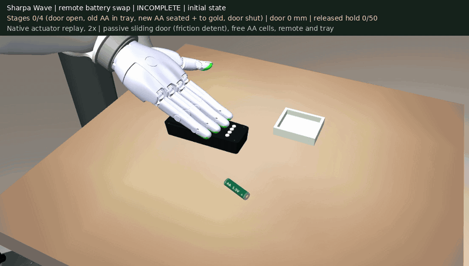

# rho-agent

rho-agent is a pure-Python AI agent CLI and library that reads code, runs commands and edits files. Because it needs only Python — no Node runtime, no browser, no background daemon — it runs anywhere Python does: your laptop, a small remote VM over SSH, a container, an edge device, or a robot.

Agents run inside an OS sandbox: they can change the project they work in, and ask before touching anything outside it. Use it from the terminal (interactively, one-shot, or via a live fleet monitor) or embed it directly in Python.

### Interactive CLI


Run `rho-agent` in a project for an interactive session (or pass a prompt to run one-shot and exit). Sessions save automatically so you can resume with `rho-agent -r latest`.

### Live fleet monitor


Run `rho-agent monitor` (or `rho-agent monitor --live` for the split-pane dashboard) to supervise running agents and their subagent trees, inspect history, answer queued approval requests, pause/cancel, or send mid-run directives. Sessions are plain files under `~/.config/rho-agent/sessions` — no daemon or server — so you can SSH onto a remote VM or edge device and run the monitor directly on the box.

## In Python

The CLI is a thin layer over three classes: `Agent` (config and tools), `Session` (one conversation), and `State` (messages, usage and trace).

```python
import asyncio
from rho_agent import Agent, AgentConfig, AgentEvent, SessionStore


def show(event: AgentEvent) -> None:
    if event.type == "tool_start":
        print(f"  {event.tool_name}")


async def main() -> None:
    agent = Agent(AgentConfig())  # workspace access: edits the current directory
    session = SessionStore().create_session(agent)  # saved, so the monitor sees it

    fixed = await session.run("The pricing tests fail. Fix the bug.", on_event=show)
    print(fixed.text)

    checked = await session.run("Run the tests and report the result in one line.")
    print(checked.text)


asyncio.run(main())
```

See the [Python SDK](docs/site/python-sdk.md) guide for events, approval callbacks, MCP servers, OpenTelemetry export and custom tools, or browse [`examples/`](examples/).

## Benchmark results

### [Terminal-Bench 2.1](https://tbench.ai/leaderboard/terminal-bench/2.1) — **79 / 89 (88.8%)**

> **Model:** `GPT-6.1 Sol` (`medium` reasoning) · **Cost:** `$10.23` · **Run:** 1 attempt/task (Nov 2026) · [experiment E007](experiments/E007-full-terminal-bench-2.1/)

Terminal-Bench 2.1 evaluates autonomous coding agents across 89 end-to-end tasks inside isolated Linux containers — spanning compiler builds, distributed PyTorch parallelism, statistical model migrations, systems debugging, and data pipelines — graded by hidden test suites with no human hints.

<details>
<summary>Results</summary>

| Category | Score | Model cost |
|---|---|---|
| Software engineering | **24 / 26 (92.3%)** | $3.84 |
| Data science and processing | **12 / 13 (92.3%)** | $1.43 |
| System administration | **7 / 9 (77.8%)** | $1.05 |
| Scientific computing | **7 / 8 (87.5%)** | $0.74 |
| Security | **6 / 8 (75.0%)** | $0.54 |
| Machine learning and model training | **7 / 7 (100%)** | $0.94 |
| Debugging | **5 / 5 (100%)** | $0.42 |
| File operations | **4 / 5 (80.0%)** | $0.82 |
| Mathematics and optimization | **4 / 5 (80.0%)** | $0.25 |
| Other (chess, scheduling, video) | **3 / 3 (100%)** | $0.21 |
| **Total** | **79 / 89 (88.8%)** | $10.23 |

</details>

### [Embodied First Exam](https://www.embodied-first-exam.ai/leaderboard/) — **21 / 39 (53.8%)**

> **Model:** `GPT-6.1 Sol` (`medium` reasoning) · **Cost:** `$85.59` · **Run:** 39 of 456 core tasks, Standard setting, 1 attempt/task (Nov 2026) · [experiment E011](experiments/E011-efe-cpu-standard-sol/)

The Embodied First Exam asks a coding agent to operate a simulated robot (an arm, a five-finger hand or a kitchen robot) toward a goal such as "open the jar" or "swap the remote's batteries" — seeing only through camera images and acting by writing Python motor commands against a 30–60 minute clock.

<details>
<summary>Results</summary>

| Segment | Score | Model cost |
|---|---|---|
| DexHand | **11 / 23 (47.8%)** | $63.22 |
| RoboCasa, RoboCasa365, RoboCasa-GR1 | **5 / 8 (62.5%)** | $16.49 |
| DexJoCo, LIBERO-MAX, MetaWorld+, VLABench | **5 / 8 (62.5%)** | $5.88 |
| **Total** | **21 / 39 (53.8%)** | $85.59 |

</details>



*DexHand remote battery swap, solved in 18.7 minutes for $0.84. Replay shows the graded episode (after one reset) at ~4× real time.*

## Setup

Requires Python 3.11+ and [uv](https://docs.astral.sh/uv/). Install from GitHub (not on PyPI yet):

```bash
# CLI (`rho-agent` and `rho-eval`)
uv tool install git+https://github.com/smith-nathanh/rho-agent

# Or as a Python library in a project
uv add git+https://github.com/smith-nathanh/rho-agent
```

rho-agent works with any OpenAI-compatible API and reads only its own `RHO_AGENT_*` variables (it never picks up `OPENAI_API_KEY`):

```bash
export RHO_AGENT_API_KEY=sk-...
```

<details>
<summary>Using other providers (OpenRouter, xAI, Groq, DeepSeek, Ollama/vLLM)</summary>

Set `RHO_AGENT_BASE_URL` and `RHO_AGENT_MODEL` (default: `gpt-6.1-terra`), or pass `--base-url` / `--model` / `--reasoning-effort` on the command line. `.env` files in the working directory are loaded automatically.

```bash
export RHO_AGENT_API_KEY=sk-or-...
export RHO_AGENT_BASE_URL=https://openrouter.ai/api/v1
export RHO_AGENT_MODEL=anthropic/claude-haiku-4.5
```

Calls use the Responses API and fall back to Chat Completions automatically when a server doesn't expose Responses. See [Installation](docs/site/installation.md) for optional extras (MCP, databases, Daytona, OpenTelemetry) and the [FAQ](docs/site/faq.md) for provider details.

</details>

## Access

`--access` (or `AgentConfig(access=...)`) controls what an agent can change:

| Access | Can write | Typical use |
|---|---|---|
| `workspace` (default) | Working directory, temp dirs, package caches | Everyday project work |
| `read-only` | Temp dirs only | Inspecting code safely |
| `full` | Anywhere (no sandbox) | Containers, CI, disposable VMs |

`workspace` and `read-only` confine every command in an OS sandbox (Seatbelt on macOS, [bubblewrap](https://github.com/containers/bubblewrap) on Linux): `.git/hooks`, `.git/config`, `~/.ssh`, `~/.aws`, and API keys stay protected, and local Unix sockets are blocked. When an agent needs more, it asks in the terminal or queues an approval in `rho-agent monitor`. Pass `--add-dir <path>` up front, use `/access` mid-session, or run `rho-agent sandbox check` to verify. See [Access](docs/site/access.md) for details and known limits.

## Documentation

| | |
|---|---|
| [Quickstart](docs/site/quickstart.md) | Get running in minutes |
| [Installation](docs/site/installation.md) | Environment setup, extras, and install options |
| [Architecture](docs/site/architecture.md) | System design, agent loop, and session protocol |
| [CLI Reference](docs/site/cli-reference.md) | Commands, flags, and usage examples |
| [Python SDK](docs/site/python-sdk.md) | Create and run agents programmatically |
| [Tools](docs/site/tools.md) | Built-in tools, databases, and MCP servers |
| [Access](docs/site/access.md) | Sandbox policy, access levels, and approvals |
| [Daytona](docs/site/daytona.md) | Remote cloud sandbox execution via Daytona |
| [Observability](docs/site/observability.md) | Session traces, offline inspection, and OpenTelemetry |
| [Export](rho_agent/export/README.md) | Convert traces to ATIF or OTLP |
| [Monitor](docs/site/monitor.md) | Watch, control, and steer running agents |
| [Prompt files](docs/site/prompt-files.md) | Reusable prompts with variables |
| [Continuum](docs/site/continuum.md) | Build a project from a requirements doc across sessions |
| [FAQ](docs/site/faq.md) | Models, reasoning, endpoints, and troubleshooting |

## Development

```bash
git clone https://github.com/smith-nathanh/rho-agent.git
cd rho-agent
uv sync --group dev
uv run pytest
```

The CLI and monitor recordings are generated with [`docs/demo/record.sh`](docs/demo/record.sh) against a real model using [`docs/demo/projects`](docs/demo/projects).

## License

MIT. See [LICENSE](LICENSE).
